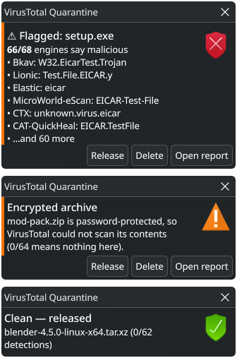

  <h1>vt-quarantine</h1>
  
Every download checked on VirusTotal before it reaches your Downloads folder

  
  
  
   
  
  
  

## What it does

Your browser saves each download into a hidden quarantine folder. vt-quarantine
locks it, looks it up on [VirusTotal](https://www.virustotal.com), and moves it to
your Downloads folder if no antivirus engine flags it. Anything flagged waits for
you, with its report a click away.

  

- **Free and open source** (MIT), for **Windows 10/11, macOS and Linux**
- **No window, no tray icon:** everything happens in notifications
- **Sets up your browsers by itself:** Chrome, Edge, Firefox, Safari, Brave and more
- **Careful by default:** files stay locked until they're checked, and private
  files are never uploaded without asking

## Install

You need a free **VirusTotal API key**: [sign up](https://www.virustotal.com/gui/join-us),
then copy it from [your API key page](https://www.virustotal.com/gui/my-apikey).
vt-quarantine asks for it the first time.

### macOS

1. Click **Download macOS** above.
2. Open **VirusTotal Quarantine** in your Downloads. It moves itself to Applications.
3. The first time, macOS blocks it: click **Done**, then **System Settings →
   Privacy & Security → Open Anyway** (near the bottom) and enter your password.
4. Paste your API key.

### Windows

1. Click **Download Windows** above, and open the file.
2. If Edge holds it ("not commonly downloaded"): **⋯ → Keep → Keep anyway**.
3. Paste your API key.

### Linux

Download the package for your system and install it, then run
**`vt-quarantine --install`** as yourself (not with `sudo`) to enter your API key.

| System | Package | Install |
|---|---|---|
| Ubuntu, Debian | [`.deb`](https://github.com/ArianARahimi/vt-quarantine/releases/latest/download/vt-quarantine-linux.deb) | `sudo apt install ./vt-quarantine-linux.deb` |
| Fedora | [`.rpm`](https://github.com/ArianARahimi/vt-quarantine/releases/latest/download/vt-quarantine-linux.rpm) | `sudo dnf install ./vt-quarantine-linux.rpm` |
| Arch | [`.pkg.tar.zst`](https://github.com/ArianARahimi/vt-quarantine/releases/latest/download/vt-quarantine-linux.pkg.tar.zst) | `sudo pacman -U vt-quarantine-linux.pkg.tar.zst` |

Anything else: download this repository (**Code → Download ZIP**) and run `sh install.sh`.

### Browser setup

vt-quarantine points your browsers at the quarantine folder by itself, and turns
off downloads opening on their own. Restart a browser that was open while it
installed. Details: [guide](docs/GUIDE.md#browser-setup).

## How it works

- **Clean** (no engine flags it): moved to Downloads, with a short note.
- **Flagged:** stays locked in quarantine. **Show report**, then **Delete** or
  **Mark as safe**.
- **Unknown to VirusTotal:** programs are uploaded for a scan; documents and
  archives ask first, since uploads can be seen by VirusTotal's paying users.
- **While you play fullscreen,** questions wait until you're done.

More: [flagged files, Mark as safe, updates, privacy, commands](docs/GUIDE.md).

## Uninstall

- **macOS:** drag **VirusTotal Quarantine** to the Trash, or open **Uninstall
  VirusTotal Quarantine** and click **Remove**.
- **Windows:** Settings → Apps → **VirusTotal Quarantine** → Uninstall.
- **Linux:** `vt-quarantine --uninstall`, then remove the package
  (`sudo apt remove vt-quarantine`, `sudo dnf remove vt-quarantine` or `sudo pacman -R vt-quarantine`).

Your browsers get their download folder back, and your API key and settings are
deleted. Files left in quarantine are unlocked, never deleted.

## Known issues

<b>Limitations</b>: what vt-quarantine can't do

- **A clean result isn't a guarantee.** New or targeted malware often has no
  detections yet. VirusTotal is one layer of protection, not a sandbox.
- **Only the quarantine folder is watched.** Other tools, and Save As dialogs
  pointed at another folder, skip it. Check such files by hand with
  `vt-quarantine --scan <file or folder>`.
- **`--scan` has only been run for real on Linux.** It uses the same checks as
  downloads, but hasn't been tried on a real Windows or Mac yet.
- **"Always open similar files" in a browser vt-quarantine doesn't know** opens a
  download before it can be locked. Turn that off in the browser's settings.
- **Programs already running as you are out of scope.** They can write to the
  quarantine folder or change vt-quarantine itself.
- **The free API allows 4 lookups a minute and 500 a day.** vt-quarantine paces
  itself; if the quota runs out, files wait in quarantine.
- **Waiting for fullscreen apps works on Windows, KDE Plasma and X11 desktops.**
  GNOME on Wayland and macOS give programs no way to tell.

<b>Windows</b>: tested on Windows 11; a few parts still only under Wine

Tested on a real Windows 11 (in a virtual machine): installing, the API key
window, notifications and their buttons, checking downloads (with Windows'
own certificate check), locking files, the quarantine folder (hidden, and made
again if deleted), browser setup for Chrome, Edge, Brave and Opera GX (with
"Always open files of this type" turned off again), waiting while
something is fullscreen, the clipboard, upgrading by hand (the key is kept)
and uninstalling.

- **Automatic updates have only run under Wine.** Downloading the new `.msi`
  and installing it silently passed there; on Windows they need a newer
  release to update to.
- **The installer is unsigned.** Edge holds the download ("isn't commonly
  downloaded": **⋯ → Keep → Keep anyway**) until it's code-signed and known.
- **Firefox, Waterfox, LibreWolf, Floorp, Chromium, Vivaldi and Opera** are set
  up the same way as the tested browsers, but only unit tests have run them.
- **Opera GX asks where to save programs** (.exe, .msi) even with "Ask where to
  save" off, and Opera probably does too. The box opens in the quarantine
  folder, so Save keeps the file in quarantine; other downloads go there
  without asking.
- **Uninstalling while a Chromium-based browser (Chrome, Edge, Brave, Opera) is open
  leaves its downloads going to the quarantine folder**, since it would write
  the old setting back over the change. The folder is then left in sight in
  your Downloads folder; set the browser's download folder back in its
  settings, or close it before uninstalling.
- **Upgrading by hand from 2.2.x asks to close "Python" once.** That's the old
  version's installer; OK closes vt-quarantine and the upgrade goes on. Newer
  installers stop it themselves.
- **64-bit Windows only.** The `.msi` carries 64-bit Python and refuses to
  install on 32-bit Windows. Windows on ARM should run it through emulation,
  but that's untested.
- **Version 2.1.2 and older don't update to 2.2.0 by themselves on Windows.**
  They look for a `setup.exe`, which releases no longer have. Install the `.msi`
  over them once.

<b>macOS</b>: tested on macOS 26 Tahoe; a few parts only in unit tests

Tested on macOS 26 on an Intel Mac (in a virtual machine): the app (Open Anyway,
the API key dialog, starting at sign-in, opening it again, removing it by the
Trash, by Uninstall VirusTotal Quarantine and from the app itself),
the Terminal line and `install.command`, the Keychain, Safari, Chrome and
Firefox set up by themselves (Safari put back on uninstall), file locking, and
downloads in all three: clean ones moved to
Downloads, flagged ones shown with Show report, Delete and Mark as safe, unknown
ones with Upload.

- **The app is untested on Apple silicon Macs** (M1 and later). It carries a
  Python built for them, which should run, but no one has tried it yet.
- **Automatic updates are untested on a Mac.** They need a newer release to
  update to.
- **Brave, Edge, Opera, Vivaldi, Chromium and LibreWolf are untested on a Mac**;
  they use the same code as Chrome and Firefox.
- **The app is unsigned**, so it needs Open Anyway the first time. A signed app
  needs an Apple Developer membership.
- **Installed without the app, macOS lists it as "python3"** under Login Items
  & Extensions (the app's own copy is listed as vt-quarantine).
- **Dragging the app to the Trash removes vt-quarantine** only if the app was
  opened from Applications (opened from Downloads, macOS runs a temporary copy).
  Whether it was thrown away or just moved is asked of Spotlight: with Spotlight
  turned off, moving the app to another folder counts as throwing it away.
  Uninstall VirusTotal Quarantine always works.

<b>Linux packages</b>: tested on KDE Plasma (Arch) and GNOME (Fedora, Ubuntu)

- **Tested on real desktops:** the Arch package on KDE Plasma, including an
  update through the notification; the .rpm on Fedora 44 and the .deb on
  Ubuntu 26.04, both GNOME on Wayland (live sessions): installing, setting up
  Firefox (on Ubuntu the Snap), clean and flagged downloads with every button,
  uninstalling and removing the package. GitHub Actions also installs and
  removes each package on Debian 13, Ubuntu 24.04 and 22.04, Fedora 45 and Arch.
- **Not yet tested with the .deb and .rpm:** an update through the
  notification, and keeping the API key in GNOME Keyring (a live session has
  no keyring, so the key went to the plain file, as designed).
- **Other RPM-based distributions are untested.** On openSUSE the dependency
  names may differ. RHEL, Alma and Rocky Linux need EPEL for `python3-jeepney`.
- **An update from your package manager takes effect at your next sign-in.**
  `systemctl --user restart vt-quarantine` switches straight away. Updates
  through the notification restart it themselves.
- **Browser setup on Linux has run for real with Brave (Flatpak) on KDE
  Plasma**: set up while closed (also after it was killed), a real download
  went through quarantine, and uninstalling put it back. Chrome, Chromium,
  Vivaldi, Opera and Edge use the same code with their own folders (including
  Flatpak and the Chromium Snap), tested in unit tests only. The default browser
  is found through `xdg-settings`.
- **Remove the package only after `vt-quarantine --uninstall`.** Otherwise it
  keeps running until you sign out, and systemd warns about a leftover link.

## More

[Guide](docs/GUIDE.md) (browser setup, flagged files, updates, privacy, commands,
where things live) · [Development](docs/DEVELOPMENT.md) (building, testing,
releasing) · [MIT License](LICENSE)
