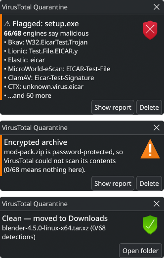

# vt-quarantine

Holds browser downloads in a quarantine folder until VirusTotal has checked
them. Clean files move to your Downloads folder on their own. Anything flagged
waits for you to decide.

A small background program for **Windows 10/11, Linux and macOS**, driven
entirely through notifications. The only thing it needs is Python; on Windows
the setup installs that for you if it's missing.

<p align="center">
  
</p>

## Install

You need a free [VirusTotal API key](https://www.virustotal.com/gui/my-apikey)
(sign up, then copy the key from that page).

**Windows:** download **`vt-quarantine-<version>-setup.exe`** from
[Releases](https://github.com/ArianARahimi/vt-quarantine/releases) and run it.
It asks for your API key and installs for your account only, with no
administrator rights needed. If there's no Python 3.11 or newer, it downloads Python from
python.org first. It checks the download against a pinned SHA-256 and installs
only the parts it needs: no launcher, file associations, shortcuts or PATH changes.
Windows may warn that the publisher is unknown: **More info → Run anyway**.

For deployment tools (Intune, Group Policy, `msiexec /i … /qn`) there's also
`vt-quarantine-<version>.msi`. It installs the same thing but needs Python to be
there already.

**Linux:** download the package for your distribution from
[Releases](https://github.com/ArianARahimi/vt-quarantine/releases) and install it:

| | |
|---|---|
| **Debian, Ubuntu** | `sudo apt install ./vt-quarantine_<version>-1_all.deb` |
| **Fedora** | `sudo dnf install ./vt-quarantine-<version>-1.noarch.rpm` |
| **Arch** | `sudo pacman -U vt-quarantine-<version>-1-any.pkg.tar.zst` |

Then run `vt-quarantine --install` as yourself (not with `sudo`). It asks for
your API key and turns it on for your account. The package brings its one
dependency (jeepney) from your distribution, so nothing is downloaded at
runtime. On any other distribution, download this repository
(**Code → Download ZIP**), extract it, and run `sh install.sh`.

**macOS:** download this repository (**Code → Download ZIP**), extract it, and
double-click **`install.command`** (the first time: right-click → Open). It asks
for your API key, copies the program to its own folder, and sets it to start
whenever you sign in.

Then, on every system, there's one manual step: point your browser's download
folder at the quarantine folder (the Windows setup shows it with a **Copy**
button):

| | Quarantine folder |
|---|---|
| Windows | `%USERPROFILE%\Downloads\.quarantine` (or wherever your Downloads folder lives) |
| macOS | `~/Downloads/.quarantine` |
| Linux | `~/Downloads/.quarantine` (follows `XDG_DOWNLOAD_DIR`) |

- **Chrome, Edge, Brave, Vivaldi, Opera:** Settings → Downloads → Location →
  Change. Turn off "Ask where to save each file".
- **Firefox, Waterfox, LibreWolf:** Settings → General → Downloads → Save files
  to → Browse. Or append [`browser/user.js`](browser/user.js) to your profile's
  `user.js`.
- **Safari:** Settings → General → File download location → Other.

On macOS the folder picker hides dot-folders: press <kbd>⌘</kbd><kbd>⇧</kbd><kbd>.</kbd>
to show them. On Linux (GTK dialogs) press <kbd>Ctrl</kbd><kbd>H</kbd>.

To check that notifications work, run the program with `--test-notification`.

### Uninstall

**Windows:** Settings → Apps → **VirusTotal Quarantine** → Uninstall. This
removes the program, its autostart entry, API key, log and downloaded packages.
Python stays installed, because other programs may use it; it's listed
separately in Apps if you want it gone too.

**macOS and Linux:** run `vt-quarantine --uninstall`. It stops the program,
removes the autostart entry, and offers to delete your API key and downloaded
packages. If you installed a Linux package, remove it after that with
`sudo apt remove vt-quarantine`, `sudo dnf remove vt-quarantine` or
`sudo pacman -R vt-quarantine`.

Files still in quarantine are never deleted. Afterwards, set your browser's
download folder back to Downloads.

## How it works

1. The browser saves every download to the quarantine folder.
2. The program waits for the download to finish (no `.part`/`.crdownload`
   file, size stable), hashes it, and looks up the SHA-256 on VirusTotal
   (API v3).
3. Then, depending on the result:

| Result | What happens |
|---|---|
| 0 malicious, 0 suspicious | Moved to Downloads, with a short "Clean — moved to Downloads" note and an **Open folder** button |
| Flagged by any engine | Notification listing the engines, with **Show report** and **Delete** (see below) |
| Password-protected archive with 0 detections | Held, with a warning: engines can't see inside, so "clean" means nothing |
| Unknown executable, script or installer | Uploaded to VirusTotal automatically, then handled as above |
| Unknown other file (documents, media, archives, disk images, …) | Asks: **Upload**, **Delete** or **Mark as safe** (see [Privacy](#privacy)) |
| Marked safe before (the exact same file, and VirusTotal still has no verdict) | Moved to Downloads without asking again. If VirusTotal has flagged it since, you get the warning |
| Known but still queued on VT | Waits for the analysis. VT returns all-zero stats for a queued file, and those are never treated as clean |
| Changed after it was hashed | Checked again; a verdict only ever applies to the exact contents that were checked |

While a scan is running, a "Scanning on VirusTotal" notification with a
**Show report** button stays up. VirusTotal scans can take several minutes.

### Taking a flagged file out of quarantine

A flagged file can't leave quarantine until you've looked at its report:

1. At first there are only **Show report** and **Delete**.
2. After **Show report**, the notification comes back with a third button,
   **Mark as safe**. The other two stay exactly where they were, so a click by
   position never lands on the wrong one.
3. When 10 or more engines call the file malicious, **Mark as safe** asks once
   more: **Back**, **Delete** or **Move anyway**, in the same three places.

A flagged file you move this way is **not** remembered: download it again and
you get the warning again, so one mis-click can't let it through for good.

### Files marked safe

**Mark as safe** is remembered only for files VirusTotal has no verdict on:
unknown documents, archives and disk images you chose not to upload, files no
engine could scan, and password-protected archives. The program remembers the
exact file by its SHA-256 hash, so when you download it again it skips the
question. It's still looked up on VirusTotal first: if it has been flagged
since, you get the warning, and if the check fails, you're asked as usual. A
changed file with the same name is a different file and gets asked about.
`vt-quarantine --forget-safe` clears the list.

**Delete** shows a short "Deleted" note, so you know it worked.

If you dismiss a notification, the file stays in quarantine until the program
restarts (next sign-in).

The free public API allows 4 requests a minute and 500 a day. The program
spaces out its requests to stay under that limit and waits out any 429
responses.

### Notifications on each platform

- **Windows:** toast notifications. Ones that need a decision stay on screen
  until you press a button.
- **Linux:** standard desktop notifications (KDE Plasma, GNOME, dunst, …;
  the notification daemon must support buttons).
- **macOS:** a dialog when a decision is needed, a Notification Center banner
  otherwise. A dialog that gets no answer within a day counts as dismissed.

## Updates

Once a day the program asks GitHub for the newest stable release. A newer one
is only installed if two checks pass:

- its list of files and their SHA-256 hashes (`SHA256SUMS`) carries a valid
  Ed25519 signature from the release key;
- the file it downloads matches that list.

The release key never leaves the maintainer's computer, so even someone who took
over the GitHub account couldn't get code onto yours.

| Installed with | How it updates |
|---|---|
| `install.sh`, `install.command` or `--install` | Replaces its own copy and restarts, never in the middle of checking a download |
| Windows setup or `.msi` | Downloads the new setup and runs it silently |
| Linux package | Asks first, because installing needs your password (through `pkexec`) |
| A git checkout | Doesn't update itself |

After an update, a short notification says so. `vt-quarantine --auto-update off`
turns this off, and then the program never contacts GitHub; `--auto-update on`
turns it back on.

## Privacy

- **Known files are never uploaded.** Only the SHA-256 hash is sent.
  VirusTotal doesn't learn the file's contents or name, though it does see
  which API key looked the hash up.
- **Uploaded files are not private.** Anything uploaded to VirusTotal can be
  downloaded by its paying subscribers. That's why only executables, scripts
  and installers upload automatically. Documents, media and archives (which
  could hold private files) ask first.
- **Uploads go out as `sample.<ext>`**, not under the original filename.
- **Uploads are tied to your API key's account.** VirusTotal attributes each
  submission to the key that sent it.
- **No telemetry.** The program talks to `www.virustotal.com`, once on first
  run to PyPI (see below), and once a day to GitHub to look for updates (only
  your IP address and the program's version reach GitHub; turn it off with
  `--auto-update off`). Nothing else.

## Security

- **Dependencies are pinned and hash-checked.** Besides Python's standard
  library, the program needs [jeepney](https://pypi.org/project/jeepney/) on
  Linux (D-Bus) and the [winrt](https://pypi.org/project/winrt-runtime/)
  packages on Windows (toasts). macOS needs nothing extra. On first run they're
  downloaded from PyPI and checked against SHA-256 hashes built into the
  program, then unpacked into its own folder. No pip, no build step, nothing
  installed system-wide. A package that doesn't match its hash is refused.
- **The API key only goes to VirusTotal.** It's sent over HTTPS to
  `www.virustotal.com` and nowhere else. Redirects aren't followed, so the key
  can't be forwarded to another host. The key file is readable only by you.
- **Untrusted filenames stay inert.** They're escaped in notifications, passed
  to macOS dialogs as data rather than script, and never put into upload
  headers.
- **Symlinks are refused.** A link planted in the quarantine folder isn't
  followed.
- **One copy at a time.** A second instance exits instead of racing the first.
- **Doesn't run as root.**
- On Windows, files moved to Downloads keep their "downloaded from the internet" mark,
  so SmartScreen and Office still treat them with caution.

## Limitations

- **A clean result is not a guarantee.** New or targeted malware often has no
  detections yet. VirusTotal is one layer of protection, not a sandbox.
- **Only the quarantine folder is covered.** Downloads made by other browsers,
  profiles or tools don't go through it.
- **Save As goes where you choose.** "Save Link As", "Save Page As" and other
  Save As dialogs skip the quarantine if you pick another folder. In Firefox,
  Waterfox and LibreWolf, [`browser/user.js`](browser/user.js) makes the dialog
  start in the quarantine folder.
- **Other programs running as you are out of scope.** Anything running under
  your account can write to the quarantine folder or edit the program itself.
- **API quota.** If the quota runs out, files stay in quarantine and you're
  asked what to do. A failed check never moves a file to Downloads.
- **macOS support is the newest** and has had the least real-world use.

## Known issues (Windows)

Windows support has only been tested under Wine on Linux, not on a real
Windows 10 or 11 PC. Anything Wine can't do, or that only behaves like
Windows on a real machine, is unverified:

- **Automatic updates haven't run on Windows yet.** Downloading the new setup
  and running it silently is covered by unit tests only.
- **Notifications have never been shown on real Windows.** Wine can't display
  toast notifications, so the buttons (Show report / Delete / Mark as safe, Enter
  key), notifications that stay on screen until answered, and what happens
  when one is dismissed or goes to the notification centre are all untested.
  This is the part most likely to need fixes.
- **The installers are unsigned.** Windows SmartScreen shows "Windows protected
  your PC" (More info → Run anyway) until they're code-signed.
- **Only 64-bit Intel/AMD Windows was tested.** On ARM64 and 32-bit Windows,
  setup downloads a different Python installer, and that path has never run.
- **Starting right after an `.msi` install is untested.** The `.msi` starts the
  program itself once installed. On real Windows that runs inside the Windows
  Installer service, which Wine doesn't reproduce. If it doesn't start, it will
  at the next sign-in. `setup.exe` starts it a second way, so it's unaffected.
- **Upgrading with the `.msi` alone lost the API key under Wine.** Wine doesn't
  tell the old version it's being upgraded, so the old version's uninstall step
  deletes the key and downloaded packages. Real Windows passes this on, so it
  shouldn't happen there, but that's untested. `setup.exe` puts the key back
  either way.
- **The "Enter key" console window is untested.** If no API key is set, a
  notification button opens a window to type it in, which depends on
  notifications working (see above).
- **Untested wizard controls:** the **Copy** button on the last page of setup,
  and the "Get a free API key" and "Help for other browsers" links.
- **Reinstalling the same version from a different build is untested**
  (Windows Installer error 1638, which setup.exe tries to handle).
- **The `.msi` may miss a Python installed "for all users".** It searches the
  64-bit registry from a 32-bit package, and whether Windows allows that is
  untested. `setup.exe` finds that Python itself and passes it along, so it's
  unaffected.
- **Uninstalling after Python has been removed leaves files behind.** The
  cleanup step needs Python. Without it, the API key, log and downloaded
  packages stay in `%APPDATA%\vt-quarantine` and `%LOCALAPPDATA%\vt-quarantine`;
  delete those folders by hand.
- **Under Wine only:** Apps-list entries are stored in a different registry
  location than on Windows, and the last setup page sometimes drew its bottom
  line late. Neither is expected on real Windows.

## Known issues (Linux packages)

- **Only the Arch package has run on a real desktop** (KDE Plasma). GitHub
  Actions installs and removes each package on Debian 13, Ubuntu 24.04 and
  22.04, Fedora 45 and Arch, and checks that the program finds the
  distribution's jeepney, but the .deb and .rpm haven't run on a desktop with
  notifications yet.
- **Other RPM-based distributions are untested.** On openSUSE the dependency names
  may differ. RHEL, Alma and Rocky Linux need EPEL for `python3-jeepney`.
- **Updating through the notification is untested on real systems.** It installs
  the package through `pkexec`, which needs the password prompt that desktop
  environments provide.
- **An update from your package manager takes effect at your next sign-in.** The
  copy that's running keeps going until then; `systemctl --user restart
  vt-quarantine` switches straight away. (Updates through the notification restart
  it themselves.)
- **Remove the package only after `vt-quarantine --uninstall`.** Otherwise the
  program keeps running until you sign out, and systemd warns about a leftover
  link to the removed service.

## Commands

```
vt-quarantine                     run (what autostart does)
vt-quarantine --install           set up, ask for the API key, start at sign-in
vt-quarantine --uninstall         stop and remove autostart
vt-quarantine --set-key           save or replace the API key
vt-quarantine --check             fetch missing packages and check notifications
vt-quarantine --test-notification show a test notification with buttons
vt-quarantine --auto-update off   stop checking for updates (on: start again)
vt-quarantine --forget-safe       forget the files you marked safe
vt-quarantine --version
```

On Windows the setup covers installing, the API key (run it again to change
the key) and uninstalling. For troubleshooting, run the installed program with
the Python it uses, in a Command Prompt:

```
"%LOCALAPPDATA%\Programs\Python\Python314\python.exe" "%LOCALAPPDATA%\vt-quarantine\vt-quarantine.py" --check
```

(If you already had Python, use yours; the Run entry under "Where things live"
shows which one it is.)

## Where things live

| | Windows | macOS | Linux |
|---|---|---|---|
| Program | `%LOCALAPPDATA%\vt-quarantine\vt-quarantine.py` | `~/Library/Application Support/vt-quarantine/` | `/usr/bin/vt-quarantine` (package) or `~/.local/share/vt-quarantine/` |
| API key | `%APPDATA%\vt-quarantine\api_key` | `~/Library/Application Support/vt-quarantine/api_key` | `~/.config/vt-quarantine/api_key` |
| Files marked safe | `%APPDATA%\vt-quarantine\marked-safe` | `~/Library/Application Support/vt-quarantine/marked-safe` | `~/.config/vt-quarantine/marked-safe` |
| Log | `%LOCALAPPDATA%\vt-quarantine\vt-quarantine.log` | `~/Library/Application Support/vt-quarantine/vt-quarantine.log` | `journalctl --user -u vt-quarantine -f` |
| Autostart | `HKCU\…\CurrentVersion\Run` | `~/Library/LaunchAgents/vt-quarantine.plist` | `~/.config/systemd/user/vt-quarantine.service` |

If a download never shows up in Downloads, check the log and the quarantine
folder.

## Manual install (Linux, systemd)

If you'd rather keep the program in `~/.local/bin` (for example as a symlink
into a git checkout) than use `--install`:

```sh
install -Dm755 vt-quarantine ~/.local/bin/vt-quarantine
install -Dm644 systemd/vt-quarantine.service ~/.config/systemd/user/vt-quarantine.service
~/.local/bin/vt-quarantine --set-key
systemctl --user daemon-reload
systemctl --user enable --now vt-quarantine.service
```

## Building the Windows installers

`python3 windows/build.py` makes both installers in `dist/`. It runs on Linux
and needs `wixl` (from msitools) and `makensis` (NSIS) on the PATH; on
Debian/Ubuntu: `apt install wixl nsis`. The pinned Python version and its
hashes are at the top of [`windows/setup.nsi`](windows/setup.nsi).

Pushing a version tag (`git tag v2.0.0 && git push origin v2.0.0`, matching
`VERSION` in the program) makes GitHub Actions build both and attach them, with
a `SHA256SUMS` file, to a draft release. Nothing is public until you publish
that draft.

## Building the Linux packages

`linux/build.sh deb`, `linux/build.sh rpm` or `linux/build.sh arch` builds the
package into `dist/`, with each distribution's own tools: `dpkg-deb` on Debian
or Ubuntu, `rpmbuild` on Fedora, `makepkg` on Arch (not as root). The same version
tag that builds the Windows installers builds and tests these too.

## Releasing

1. Once: `tools/make-release-key.sh` makes the release key (it asks for a
   passphrase) and prints its public half, which goes into `RELEASE_KEYS` in
   `vt-quarantine`. Back up the key and passphrase: without them no update can
   reach installed copies.
2. Set `VERSION` in `vt-quarantine`, commit, then `git tag vX.Y.Z && git push
   origin vX.Y.Z`. GitHub Actions builds and tests everything and makes a draft
   release.
3. `tools/sign-release.sh vX.Y.Z` checks every file against `SHA256SUMS`, signs
   it, confirms the release's own program accepts the signature, uploads
   `SHA256SUMS.sig` and offers to publish.

## Configuration

Settings are constants at the top of `vt-quarantine`: poll interval, rate
limit, upload size limits, analysis timeout, and the list of file types that
are uploaded without asking.

## License

MIT
